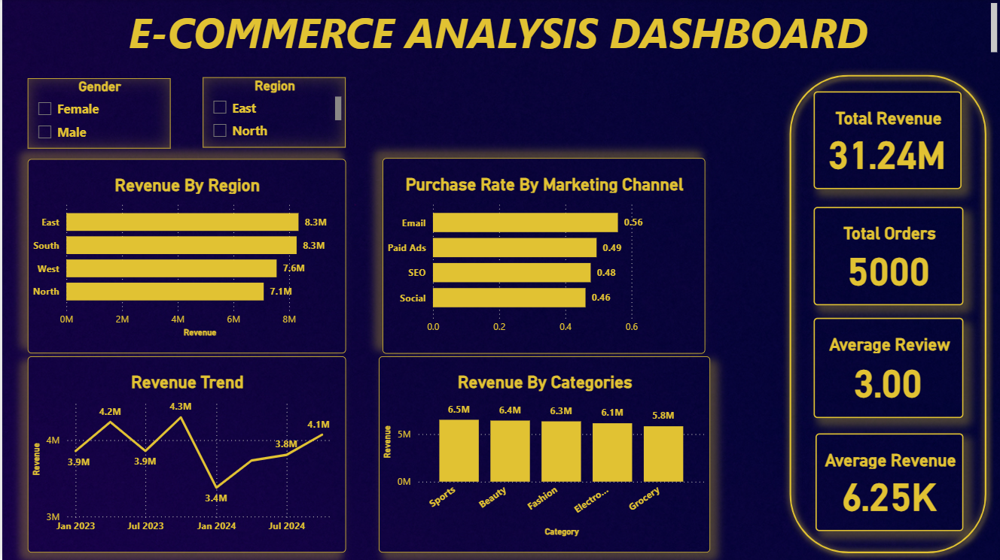
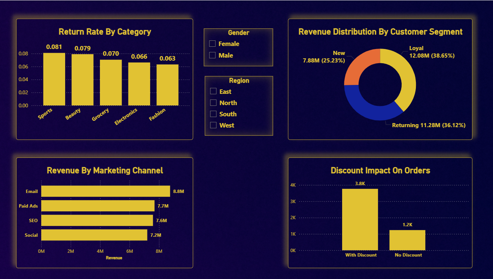
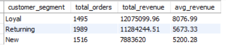
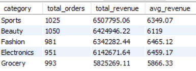
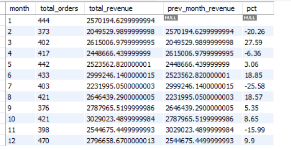
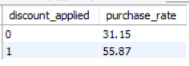
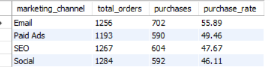
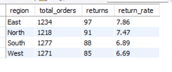

# E-Commerce Sales & Customer Behavior Analytics

Explore how customers shop, what drives sales, and where an e-commerce business can improve. This project brings together Python analysis, SQL queries, statistical testing, machine learning, and an interactive Power BI dashboard.

> **New here?** Start with the [dashboard](#power-bi-dashboard), browse the [key findings](#what-the-analysis-found), or run the [notebook](#run-the-analysis).

## What’s in the project?

- **Sales and customer analysis:** Explore revenue, customer segments, returns, discounts, and marketing channels.
- **Statistical tests:** Check whether revenue differs across customer segments and discount groups.
- **Purchase prediction:** Compare models that estimate whether a customer will make a purchase.
- **Interactive reporting:** Explore the results in Power BI.

## Project files

| File or folder | What it’s for |
| --- | --- |
| [`e_commerce.xlsx`](e_commerce.xlsx) | Dataset used in the analysis |
| [`ecom_nb.ipynb`](ecom_nb.ipynb) | Python notebook for data checks, exploration, statistics, and machine learning |
| [`ecommerce_sql.sql`](ecommerce_sql.sql) | MySQL queries for common business questions |
| [`ecommerce.pbix`](ecommerce.pbix) | Power BI dashboard |
| [`image/`](image/) | Charts and dashboard screenshots shown below |

## See the results

### Power BI dashboard

Open [`ecommerce.pbix`](ecommerce.pbix) with Power BI Desktop to explore the dashboard.





### Selected analysis charts

| Customer segments | Revenue by category |
| --- | --- |
|  |  |

| Monthly revenue | Discount impact |
| --- | --- |
|  |  |

| Marketing channel | Returns by region |
| --- | --- |
|  |  |

## Run the analysis

### Python notebook

1. Clone or download this repository and open its folder.
2. Install Python and Jupyter, then install the libraries used by the notebook:

   ```bash
   python -m pip install jupyter pandas numpy matplotlib seaborn scipy statsmodels scikit-learn openpyxl
   ```

3. Start Jupyter and open `ecom_nb.ipynb`:

   ```bash
   jupyter notebook
   ```

4. Run the cells from top to bottom. The notebook reads `e_commerce.xlsx` from the project folder.

### SQL queries

The SQL file is written for MySQL. It creates and selects the `ecommerce` database, then queries an `ecommerce` table. Before running the analysis queries, load the spreadsheet data into a MySQL table named `ecommerce` with the expected columns.

The queries cover:

- Revenue and order counts by category
- Purchase rate by marketing channel
- Monthly revenue and month-over-month change
- Return rate by region
- Revenue by customer segment
- Purchase rate for discounted and non-discounted orders

## What the analysis found

- **Customer segments:** The notebook found a statistically significant revenue difference across customer segments (one-way ANOVA, *p* = 1.14 × 10⁻¹⁸). Loyal customers had the highest reported average revenue: **8,076.99**.
- **Discounts:** Revenue differed between discount groups in the notebook’s independent t-test (*p* = 3.67 × 10⁻⁹). The reported average was **6,699** for discounted orders and **4,875** for orders without a discount.
- **Purchase rates:** Discounted orders had a reported purchase rate of **55.87%**, compared with **31.15%** for non-discounted orders. Email had the highest reported channel purchase rate at **55.89%**.
- **Returns:** The East region had the highest reported return rate at **7.86%**.
- **Seasonality:** Revenue peaked in months **6** and **10** in the analysis.

These results describe patterns in this dataset. They can help guide follow-up questions, but they do not by themselves prove that discounts or marketing channels caused a change in behavior.

## Purchase prediction

The notebook predicts `purchase_made` (0 or 1) using customer and shopping features. It encodes categorical variables, excludes transaction-derived columns to reduce leakage, and uses an 80/20 train/test split.

| Model | Accuracy | Precision (purchase) | Recall (purchase) | F1 (purchase) |
| --- | ---: | ---: | ---: | ---: |
| Logistic Regression | 62.4% | 0.61 | 0.64 | 0.63 |
| Random Forest (default) | 56.9% | 0.56 | 0.59 | 0.58 |
| Random Forest (tuned) | 61.5% | 0.59 | 0.69 | 0.64 |
| Random Forest (threshold 0.3) | 54.4% | 0.52 | 0.94 | 0.67 |

The threshold-adjusted Random Forest catches more potential purchasers, but it also labels more non-purchasers as likely buyers. That trade-off may be useful for a marketing campaign where missing a potential buyer is considered more costly than sending an extra promotion. Model metrics are specific to this dataset and train/test split.

## Tools used

- **Python:** pandas, NumPy, Matplotlib, Seaborn, SciPy, Statsmodels, scikit-learn
- **Database:** MySQL
- **Dashboard:** Power BI

## Notes

The analysis and business recommendations are based on the dataset and results included in this repository. Validate findings with current business data before making operational or marketing decisions.
